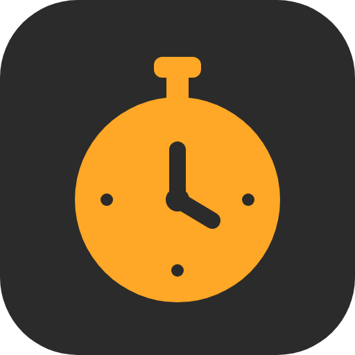
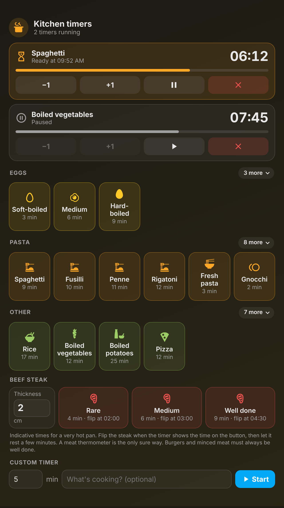

# Kitchen Timer Card

<p align="center"></p>

[](https://my.home-assistant.io/redirect/hacs_repository/?owner=Diess-tech&repository=kitchen-timer-card&category=plugin)
[](https://github.com/Diess-tech/kitchen-timer-card/releases)
[](https://github.com/Diess-tech/kitchen-timer-card/releases)
[](LICENSE)

<a href="https://buymeacoffee.com/diesstech"></a>
<a href="https://ko-fi.com/diesstech"></a>
<a href="https://paypal.me/diesstech"></a>

A Home Assistant dashboard card for **one-tap cooking timers**: tap *Spaghetti* and a 9-minute timer starts. It's made for a tablet in the kitchen, but it works anywhere.



- **Ready-made buttons** grouped by type (eggs, pasta, rice…), with an icon and a colour for each group. Change the list or leave the built-in one, available in English and Italian.
- **More options one tap away**: each group shows the everyday buttons, and a *more* button opens the rest (linguine, farfalle, paccheri, basmati rice…).
- **Beef steak** by thickness: pick the thickness in cm and *rare*, *medium* or *well done*. The timer name tells you when to flip it.
- Several timers can run at once. Each tap uses the **first free timer**.
- Each running timer shows a **big countdown**, the time it will be ready, a progress bar and the buttons **−1 min, +1 min, pause/resume and cancel**.
- A **custom timer** with any number of minutes and an optional name.
- When a timer ends, the card shows a **"ready!" banner** and plays a **beep** in the browser.
- It runs on Home Assistant's own **timer helpers**, so the timers keep going when the screen is off and **automations can react** to them, for example with a voice announcement.
- No dependencies: no Mushroom, card-mod or other cards needed.

## Installation

### HACS (custom repository)

[](https://my.home-assistant.io/redirect/hacs_repository/?owner=Diess-tech&repository=kitchen-timer-card&category=plugin)

Click the button above, or do it by hand:

1. HACS → ⋮ → **Custom repositories**.
2. Add `https://github.com/Diess-tech/kitchen-timer-card` with category **Dashboard**.
3. Install **Kitchen Timer Card**, then reload the browser.

### Manual
1. Copy `kitchen-timer-card.js` to `/config/www/`.
2. Go to Settings → Dashboards → ⋮ → **Resources** → add `/local/kitchen-timer-card.js` as a *JavaScript module*.

## Setup

### 1. Create the timers
Go to Settings → Devices & services → Helpers → **Create helper → Timer**. Create one timer for each thing you want to cook at the same time, for example 3 timers.

> Tip: tick **"Restore"** in the timer settings so a running timer survives a Home Assistant restart.

### 2. (Optional) Create one *Text* helper per timer
The card writes what is cooking ("Spaghetti") into the text helper, so:
- every device shows the same name (the tablet, your phone…),
- your automations can say *"the spaghetti is ready"*.

Without text helpers the name is stored only in that browser.

### 3. Add the card

```yaml
type: custom:kitchen-timer-card
timers:
  - entity: timer.kitchen_1
    name_entity: input_text.kitchen_timer_1_name
  - entity: timer.kitchen_2
    name_entity: input_text.kitchen_timer_2_name
  - timer.kitchen_3          # short form, without a name helper
```

## Options

| Option | Default | Description |
|---|---|---|
| `timers` | **required** | List of `timer.*` entities, or objects with `entity` and optional `name_entity` (`input_text.*`). |
| `title` | "Kitchen timers" | Card title. Set it to `""` to hide the header. |
| `presets` | built-in list | Your own groups of buttons (see below). |
| `show_presets` | `true` | Hide the buttons and keep only the running timers and the custom timer. |
| `custom_timer` | `true` | Show the custom timer row. |
| `custom_default` | `5` | Minutes pre-filled in the custom timer. |
| `sound` | `true` | Beep in the browser when a timer ends. |
| `language` | from HA | `en` or `it`. |

### Your own buttons

```yaml
presets:
  - group: Eggs
    color: amber                # a name (amber, orange, light-green, blue, red…) or a hex code like "#ff7043"
    items:
      - name: Soft-boiled       # text on the button
        label: Soft-boiled eggs # name given to the timer (optional, defaults to name)
        minutes: 3
        icon: mdi:egg-outline
      - { name: Hard-boiled, label: Hard-boiled eggs, minutes: 9, icon: mdi:egg }
  - group: Oven
    color: "#ff7043"
    items:
      - { name: Pizza, minutes: 12, icon: mdi:pizza }
      - { name: Roast chicken, minutes: 75, icon: mdi:food-drumstick }
```

`minutes` can be a decimal number, for example `2.5`.

Buttons listed under `more` stay hidden until you tap *more* next to the group name:

```yaml
presets:
  - group: Pasta
    color: orange
    items:
      - { name: Spaghetti, minutes: 9, icon: mdi:pasta }
    more:
      - { name: Paccheri, minutes: 13, icon: mdi:pasta }
  - type: steak                 # the beef steak row (thickness + rare / medium / well done)
    group: Beef steak
    color: red
```

With your own `presets`, the steak row appears only if you add the `type: steak` group.

## Voice announcement when a timer ends (example automation)

The beep only plays in an open browser. To be told on a speaker, use the timer events:

```yaml
alias: Kitchen timer finished
mode: parallel
triggers:
  - trigger: event
    event_type: timer.finished
    event_data:
      entity_id: timer.kitchen_1
    variables: { n: 1 }
  - trigger: event
    event_type: timer.finished
    event_data:
      entity_id: timer.kitchen_2
    variables: { n: 2 }
actions:
  - action: tts.speak
    target:
      entity_id: tts.google_translate_en_com
    data:
      media_player_entity_id: media_player.kitchen_speaker
      message: "{{ states('input_text.kitchen_timer_' ~ n ~ '_name') }} is ready!"
```

## Notes
- **Sound on tablets:** browsers allow sound only after you have touched the page. The first tap on the card unlocks it.
- **+1 minute** restarts the timer with the new remaining time. Home Assistant's `timer.change` refuses to go beyond the original duration, so the card doesn't use it.
- When all timers are busy, the card shows a short message and starts nothing.
- **Steak times are indicative**, for a very hot pan, per side by thickness (1 to 5 cm), taken from butcher and cookery guides. Pan, cut and starting temperature change them a lot: a meat thermometer is the only sure way. Burgers and minced meat must always be cooked through. Flip the steak when the countdown shows the time written in its name (it is half of the total).
- Pasta times are indicative too: check the package.

---

## 🇮🇹 In breve

Card per Home Assistant con **timer da cucina a un tocco**: tocchi *Spaghetti* e parte un timer da 9 minuti. Ha i tempi pronti per uova, pasta, riso e altro, che puoi personalizzare: quelli di tutti i giorni sono in vista, gli altri si aprono con il tasto «altre». C'è una riga per la bistecca di manzo: scegli lo spessore e la cottura (al sangue, media, ben cotta) e il nome del timer ti dice quando girarla. I tempi sono indicativi. Più un timer libero. Mostra un grande conto alla rovescia con i pulsanti −1/+1 minuto, pausa e annulla, e alla fine l'avviso "pronto!" con un bip. Usa i timer di Home Assistant, quindi le automazioni possono annunciare a voce cosa è pronto. La lingua italiana si attiva da sola se Home Assistant è in italiano.

## License
MIT © 2026 Davide Sanna
